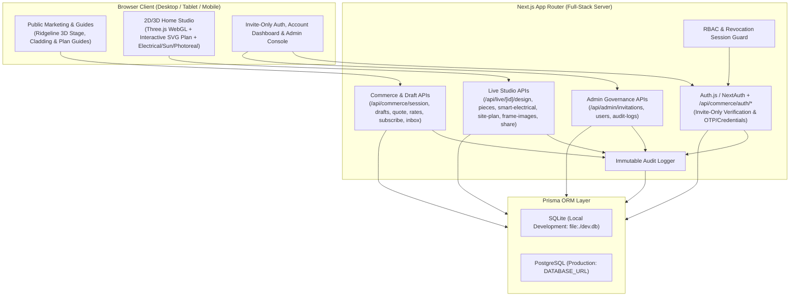

# Architecture & Data Model

## 1. High-Level System Architecture

---

## 2. Database Schema & Entity-Relationship Model

### 2.1 Core Entities

1. **`User`**
   - `id` (UUID primary key)
   - `email` (Unique, lowercase normalized)
   - `name` (Optional display name)
   - `passwordHash` (Optional bcrypt/scrypt hash for password login)
   - `emailVerified` (`DateTime?`)
   - `role` (`"ADMIN" | "BUILDER" | "AGENT" | "USER"`, default `"USER"`)
   - `status` (`"ACTIVE" | "REVOKED"`, default `"ACTIVE"`)
   - `revokedAt` (`DateTime?`), `revokedById` (`String?`), `revokedReason` (`String?`)
   - `currency` (`"USD" | "AUD" | "EUR" | "GBP"`, default `"USD"`)
   - `credits` (`Int`, default `0`)
   - `subscriptionStatus` (`String?` — `"active" | "canceled" | null`)
   - `subscriptionInterval` (`String?` — `"month" | "year" | null`)
   - `subscriptionRenewsAt` (`DateTime?`)
   - `createdAt`, `updatedAt`

2. **`InvitationCode`**
   - `id` (UUID primary key)
   - `code` (Unique token, e.g., `HM-8F4K-29QX`)
   - `role` (`"ADMIN" | "BUILDER" | "AGENT" | "USER"`, default `"USER"`)
   - `boundEmail` (`String?` — optional email restriction)
   - `maxUses` (`Int`, default `1` for single-use)
   - `usedCount` (`Int`, default `0`)
   - `status` (`"ACTIVE" | "USED" | "REVOKED" | "EXPIRED"`, default `"ACTIVE"`)
   - `expiresAt` (`DateTime`)
   - `createdById` (`String?` -> `User.id`)
   - `redeemedByUserId` (`String?` -> `User.id`)
   - `redeemedAt` (`DateTime?`)
   - `revokedAt` (`DateTime?`), `revokedById` (`String?`)
   - `note` (`String?`)
   - `createdAt`, `updatedAt`

3. **`VerificationCode`**
   - `id` (UUID primary key)
   - `email` (`String`)
   - `code` (`String` — 6-digit numeric OTP)
   - `inviteCode` (`String?` — attached invitation code for new user signup)
   - `expiresAt` (`DateTime`)
   - `usedAt` (`DateTime?`)
   - `createdAt` (`DateTime`)

4. **`AuditLog`**
   - `id` (UUID primary key)
   - `actorUserId` (`String?` -> `User.id`)
   - `actorEmail` (`String?`)
   - `action` (`String` — e.g., `SYSTEM_BOOTSTRAP_ADMIN`, `INVITE_CREATED`, `INVITE_REVOKED`, `INVITE_REDEEMED`, `USER_REGISTERED`, `USER_LOGIN`, `USER_LOGIN_FAILED`, `USER_ROLE_UPDATED`, `USER_REVOKED`, `USER_RESTORED`, `DRAFT_CREATED`, `BUILD_CREATED`, `DESIGN_UPDATED`, `SHARE_CREATED`, `SHARE_REVOKED`, `ACCOUNT_EXPORTED`, `ACCOUNT_DELETED`)
   - `targetType` (`String` — `InvitationCode`, `User`, `Draft`, `HomeBuild`, `ShareLink`, `Subscription`)
   - `targetId` (`String?`)
   - `ipAddress` (`String?`)
   - `userAgent` (`String?`)
   - `metadata` (`String` — JSON-serialized structured details)
   - `createdAt` (`DateTime`)

5. **`Draft` & `DraftFile`**
   - `Draft`: `id`, `userId`, `state` (`"open" | "paying" | "built"`), `houseWidthM` (`Float?`), `houseLengthM` (`Float?`), `unit` (`"m" | "ft"`), `consented` (`Boolean`), `paid` (`Boolean`), `buildId` (`String?`), `expiresAt`, `createdAt`, `updatedAt`.
   - `DraftFile`: `id`, `draftId`, `name`, `mimeType`, `bytes`, `dataBase64`, `pageIndex`, `createdAt`.

6. **`HomeBuild`, `HomeVersion`, `PlacedPiece`, `FrameRender`, `ShareLink`**
   - `HomeBuild`: `id`, `userId`, `draftId`, `title`, `status` (`"ready" | "building" | "failed"`), `storeys` (`Int`), `unit` (`"m" | "ft"`), `roofType` (`String`), `planJson` (`String` — full 2D/3D floor plan JSON compatible with Southern Farmhouse `plan.json`), `finishesJson` (`String` — floor/wall/outside/roof material selections), `electricalJson` (`String` — room-by-room power/light/switch schedule), `sitePlanJson` (`String` — lot boundary, North angle, sun study settings), `createdAt`, `updatedAt`.
   - `HomeVersion`: `id`, `homeBuildId`, `versionNumber`, `label`, `planJson`, `createdAt`.
   - `PlacedPiece`: `id`, `homeBuildId`, `catalogId`, `name`, `category`, `floorIndex`, `roomKey`, `x`, `y`, `z`, `rotation`, `width`, `depth`, `height`, `colour`, `createdAt`, `updatedAt`.
   - `FrameRender`: `id`, `homeBuildId`, `roomName`, `style`, `prompt`, `cameraJson`, `imageUrl`, `createdAt`.
   - `ShareLink`: `id`, `homeBuildId`, `token` (Unique), `active` (`Boolean`), `createdAt`, `revokedAt`.

7. **`SupportThread`, `SupportMessage`, `RealEstateListing`**
   - `SupportThread`: `id`, `userId`, `email`, `name`, `subject`, `status`, `createdAt`, `updatedAt`.
   - `SupportMessage`: `id`, `threadId`, `sender` (`"user" | "support"`), `body`, `createdAt`.
   - `RealEstateListing`: `id`, `userId`, `agencyName`, `address`, `suburb`, `state`, `postcode`, `homeBuildId`, `status`, `createdAt`.

---

## 3. Local SQLite vs Production PostgreSQL Strategy

- **Local Development**: `prisma/schema.prisma` uses `provider = "sqlite"` with `url = env("DATABASE_URL")` defaulting to `"file:./dev.db"`.
- **Production**: `prisma/schema.postgresql.prisma` uses `provider = "postgresql"` with `url = env("DATABASE_URL")`.
- **Zero Dummy Data**: Database migrations initialize empty tables. No demo users, fake builds, or placeholder rows are seeded. The live example (`/demo` and `/demo/try`) reads the genuine CC BY-SA 4.0 Southern Farmhouse static drawing set from `public/demos/southern-farmhouse/`.
